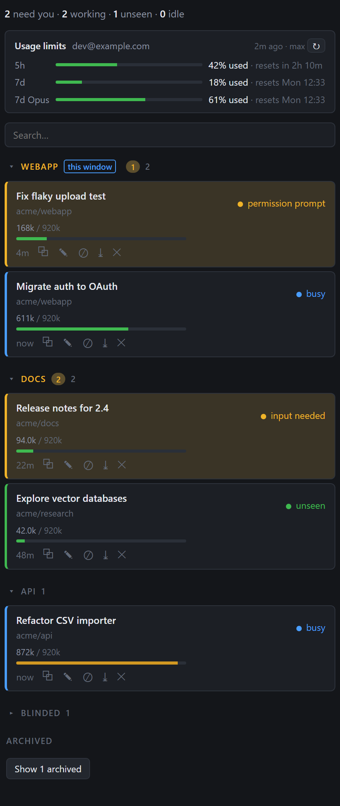
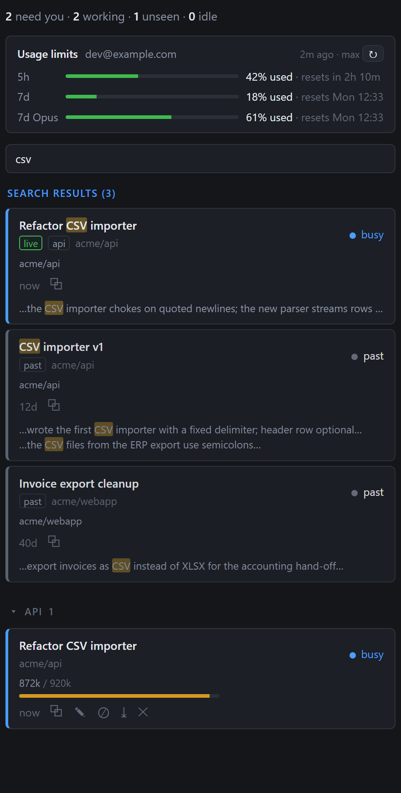

# Session Board

**Every Claude Code session you have running, in one VS Code sidebar: who needs you, who is
still working, and how much room each one has left.**

## The problem

Claude Code makes it easy to run several sessions at once: one per repository, one per
ticket, one for the long refactor you check on every hour. VS Code puts each of them in its
own window or tab, and you only find out that one has been waiting for your answer when you
happen to switch to it. Which sessions are blocked on a permission prompt right now? Which
are still working? Which one is about to run out of context? Claude Code's own agents list
shows background agents only, not the sessions you talk to.

## What Session Board does

- **One section per window.** Sessions are grouped by the VS Code window they run in, the
  window you are in first, and each heading carries the number of sessions in it that need
  you. Inside a section the ones waiting on a permission prompt, a question or a dialog come
  first, highlighted, with what they are waiting for; working and idle sessions follow, then
  the ended sessions Claude Code still lists for that folder, until you archive them. A switch
  shows the running ones only. The activity-bar badge counts the waiting ones.
- **Told when it matters.** A toast says when a session starts waiting and when one finishes
  its answer. When no VS Code window has focus, one Windows notification says it instead, and
  a click on it opens the session.
- **Unseen answers stand out.** A session whose answer ended while the board was running
  shows as unseen and counts on its heading until you open it or send it a new prompt.
- **Mute what can wait.** The bell on a row mutes a session: it stays where it is, but raises
  no toast or notification and counts nowhere, even while it waits. The struck bell unmutes it.
- **One click to the session.** A row opens its session where you keep Claude Code, sidebar
  or editor tab, and brings the right VS Code window to the front.
- **Context at a glance.** Each row shows how much of the context window the session has
  used, amber and red near the limit.
- **Your usage limits.** The 5-hour and 7-day windows sit at the top of the view with the time
  each one resets, next to the account the CLI is signed in with.
- **A title that follows the work, shared with Claude Code.** Claude Code titles a session
  from its first question; ✎ suggests a new one from the recent prompts and the last answer
  (one short haiku call) and you confirm or edit it. The title is Claude Code's own, so its
  sidebar and `claude --resume` show it too, and a rename in Claude Code shows on the board.
- **Ids you can copy.** Each row shows its agent name and "Session f8005c0d"; a click on
  either copies it (the full id for the session). ⓘ folds out the start time, process and
  transcript path, each copied by a click, and search finds a session by its id.
- **Running, open or all.** A header switch shows only the running sessions, what Claude
  Code's own list shows (the default: running plus ended ones not archived), or the archived
  ones too.
- **End a session.** ✕ ends a session and everything it started. Busy sessions ask twice.
- **Archive a session.** ⤓ ends it the same way and keeps it off the board. It also moves
  the transcript out of Claude Code's project folder, so Claude Code's own session list drops
  it too. It comes back on its own only when it needs you; "Show N archived" lists the rest,
  and ⤒ or a click brings one back, transcript first. Sessions you archive in Claude Code's
  sidebar are put away on the board as well (read from VS Code's default profile).
- **Find any session, ever.** Type to narrow the list and search every session on this
  machine by title; press Enter to search by what was said too, and resume a past one in
  place.

## Install

You need Windows, VS Code 1.100 or newer, the Claude Code extension, and the `claude`
command on your PATH.

- **Marketplace**: search for *Session Board* in the Extensions view (once published).
- **From source**: `pwsh -File build.ps1` packages the extension and installs it; see
  [DEVELOPMENT.md](DEVELOPMENT.md).

Session Board appears as a new icon in the activity bar.

## Usage limits

The strip at the top shows your 5-hour and 7-day usage windows with the time each resets,
plus per-model weekly windows and extra usage when your plan has them. Session Board asks
the Claude Code command line for these numbers the same way Claude Code's own usage screen
does: a short, hook-free run that makes no model call and uses the CLI's own login. It
refreshes every 5 minutes while the view is visible, and on ↻. Subscription plans only;
API-key billing has no limits to report.

The strip also names the account the `claude` command is signed in with (the email;
organisation and plan on hover), from `claude auth status --json`. That is the CLI's login,
one per machine, not a per-session account.

## Privacy

Everything stays on your machine. Session Board reads the session files and command-line
output that Claude Code keeps in your user profile, and talks to nothing else. It reads no
credentials and sends nothing anywhere, with one exception you trigger yourself: ✎ passes a
few KB of a session's prompts and last answer to the model through your own `claude`
command, the way a prompt in that session would.

Session Board is an independent project. It is not affiliated with or endorsed by Anthropic.

## Good to know

- Windows first: on macOS and Linux the list, the usage strip and the search work, but the
  window mapping and ending sessions do not yet; a click copies the resume command instead.
- Built against Claude Code 2.1.276 to 2.1.280. The board relies on the local files and
  command output Claude Code produces, which can change with a release; when they do, the
  board says so instead of guessing.
- Developers: [DEVELOPMENT.md](DEVELOPMENT.md) has the layout, the build, how the pieces work
  and the publishing steps. Changes are listed in
  [extension/CHANGELOG.md](extension/CHANGELOG.md).

MIT license.
