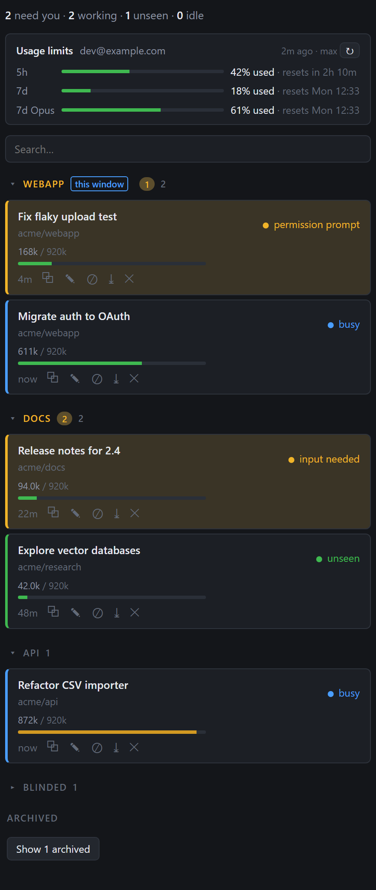

# Session Board

Your Claude Code sessions at a glance, across every VS Code window: who is waiting for you,
who is working, how much context each has used, and how much of your usage limits is left.
Click a row to jump to that session, ✕ to end it, and search every session on disk by title
or content.

Session Board is an independent, unofficial tool. It is not affiliated with or endorsed by
Anthropic; it reads the local files and CLI output that Claude Code leaves on your machine.

## Prerequisites

- Windows. Listing and search run anywhere, but the window mapping and ending a session use
  `Win32_Process` and `taskkill`; on other platforms a click copies the resume command.
- The Claude Code CLI (`claude`) on the PATH VS Code sees, and the Claude Code extension
  installed (the board opens sessions through it).
- ripgrep (`rg`) on PATH for content search; VS Code's bundled copy is used when found.
  Title search works without it.
- Tested with Claude Code 2.1.276 to 2.1.284 on VS Code 1.138. The board relies on
  undocumented Claude Code internals (`claude agents --json`, transcript line types, the
  extension's open command and URI handler), so a Claude Code release can break it; when
  the session output changes shape the board says so instead of guessing.

## What you see

- **One section per VS Code window**, named after that window's workspace (its folder, or
  the name of a multi-root workspace). The window this board runs in comes first, marked
  "this window"; the others follow by activity, and sessions started outside VS Code sit
  under **Elsewhere**. Inside a section the rows sort by what they need from you: waiting
  (`permission prompt`, `input needed`, `dialog open`), then working, then unseen (the
  answer ended while the board was running and you have not opened the session since;
  opening it or sending a new prompt clears it), then idle. Every running session that is not
  archived stays in its section, however long it has been idle; a click on the heading folds
  the whole section.
- **A typed filter says so**: while the search box holds text, a line above the sections reads
  `Filter "cuvis-ai-6c": 1 of 17 running sessions`, with a clear button (Esc does the same).
- **The number on a heading** counts the sessions in that section that wait for you (amber)
  or are unseen (green). It goes down as you answer or open them.
- Each row: the session's title (Claude Code's: a rename wins over the generated title; a
  session with neither shows its last prompt), "Session" and the first 8 characters of its
  id, its folder, status, a context bar, and time in that state. When the session's agent
  name (the one other Claude sessions use for it, such as `cuvis-ai-6c`) differs from its
  title, it shows before the id. A click on the id folds out a details line: the full id, the
  agent name, when the session started, its process, its window and its transcript path; ⧉
  copies the id, the name or the path. Search finds a session by its id, typed bare or as Claude Code shows it
  (`Session f8005c0d`).
- **Muted**: a muted session stays in its place in its window section, marked "muted" and
  dimmed, waiting or not. It raises no toast and no notification and counts nowhere: not on
  the section's number, in the counts line, the title or the activity-bar badge. The flag is
  shared by every window and the browser page, survives restarts, and lasts as long as the
  session can still be resumed.
- **Your own order**: the switch in the header picks **by activity** (the order above) or
  **manual**. In manual mode the rows keep the order you give them: drag a row by its ⋮⋮
  handle onto another row of the same section, or focus a row and press Alt+Up or Alt+Down.
  Waiting and unseen rows keep their colour and their count but stay where you put them; a
  session you have not placed yet (a new one, or one started outside the board) sits on top.
  The order and the switch are shared by every window and the browser page and survive
  restarts.
- The badge on the activity-bar icon is the number of sessions waiting on you, muted ones
  excepted.

## Notifications

- When a session starts waiting, and when a session finishes its answer, the focused VS Code
  window shows a toast with an Open button.
- When no VS Code window has focus (you are in another app), one window shows a Windows
  notification instead: "needs you" or "done". A click on it brings the session's window
  forward on that session and clears its unseen mark. Several windows never show the same
  notification twice; a burst shows three and says how many more.
- Muted sessions never notify. `sessionBoard.notifyOnDone` turns the "done" ones off,
  `sessionBoard.systemNotifications` the Windows notifications (toasts in a focused window
  stay). Windows notifications come from Windows PowerShell; if they cannot be shown, the
  board says so once and keeps the toasts.

## Actions

- **Click a row**: the session opens where you keep Claude Code (sidebar or editor tab), in
  the window that owns it, and that window comes to the front. Without a mapped window the
  resume command is copied instead.
- **⧉** copies `claude --resume <id>` (a transcript the board stowed comes back first).
- **✎ renames the session in Claude Code** with a title suggested from its progress so far:
  one short haiku call over the recent prompts and the last answer (a few KB of the
  transcript, passed through your own `claude` command the way a prompt would be), hook-free
  and without tools. The board keeps no titles of its own:
  - for a session that is not running (an ended one from the search, or a terminal session
    without a name), a box prefilled with the suggestion opens; Enter writes the title where
    Claude Code keeps it (a `custom-title` line in the transcript and `custom-title.json`
    next to it), so Claude Code's sidebar and `claude --resume` show it; Escape writes nothing;
  - for a running session, the suggestion goes onto the clipboard and Claude Code's own rename
    box opens on that session (in its window, through the board running there): a running
    session's CLI writes its own name after every answer, so only Claude Code's rename sticks.
    Paste and press Enter.
  A rename made in Claude Code shows on the board with the next poll.
- **The bell mutes the session** and the struck bell unmutes it (see Muted above). No
  confirmation; the flag changes at once.
- **⋮⋮ moves the session** (manual order only): drag it onto another row of its section, or
  press Alt+Up or Alt+Down on the focused row. No confirmation; the row moves at once and
  the whole section's order is saved.
- **✕ ends the session** and everything it started (its subagents and tool processes).
  Click once, then click `End?` within 3 s. Busy or waiting sessions ask once more; in-flight
  work is lost. The transcript stays and Claude Code's picker still offers "Resume session".
- **⤓ archives the session**: it ends it exactly like ✕ (same confirmations) and keeps it
  off the board afterwards. It also moves the transcript from `~/.claude/projects` to
  `%LOCALAPPDATA%\SessionBoard\transcripts`, so Claude Code's session list drops it at its
  next refresh. If it runs again later (a resume), it comes back on its own only when it is
  waiting for you; "Show N archived" lists the others, and ⤒, a click on the row or ⧉ brings
  one back, transcript first. While a transcript is stowed, `claude --resume <id>` and
  Claude Code's own picker do not find the session. A session archived in Claude Code's
  sidebar is put away here too, with the chip "archived in Claude Code"; unarchive it there.
  That flag is read from VS Code's default profile; other profiles, portable installs and
  custom user-data folders are not seen.
- **Search**: typing narrows the live list. Enter searches every session on disk by title,
  folder, id and transcript text (literal, case-insensitive, raw transcript text including
  tool output); Esc or an emptied box clears. Results show live or past, the folder, up to
  two snippets, and whether the pass was partial. Click a past session to resume it in this
  window when its folder is open here; otherwise the resume command is copied and you can
  open the folder in a new window as the first step. Archived sessions carry an `archived`
  chip, or "archived in Claude Code"; a click on a board-archived row brings the transcript
  back before it resumes.
- Command palette: **Session Board: Open Session…**, **Session Board: Search Sessions…**,
  **Session Board: Refresh Usage Limits**, **Session Board: Refresh**. Output panel channel
  **Session Board** logs each decision.

## Context marks

The bar appears when `autoCompactWindow` is set in `~/.claude/settings.json`; it turns amber
at the save mark (`CONTEXT_GUARD_THRESHOLD_TOKENS`, default 92 % of the window) and red at
the window. Without the setting the row shows the token count only.

## Usage limits

The strip at the top shows how much of your 5-hour and 7-day usage windows is used and when
each resets, plus per-model weekly windows and extra usage when your plan has them. Session
Board asks the `claude` command line for these numbers the same way Claude Code's own usage
screen does: a short, hook-free run that makes no model call, starts no MCP server, leaves
no transcript, and uses the CLI's own login. The board reads no credentials and, apart from
✎, sends nothing anywhere. Refreshed every 5 minutes while the view is visible (15 when hidden) and on ↻;
when a refresh fails the last numbers stay, with the failure noted underneath. Subscription
plans only: with API-key billing Claude Code reports no limits.

The strip head also names the account the `claude` command is signed in with: the email, with
organisation and plan on hover, read from `claude auth status --json` next to the usage probe.
It is the CLI's login, one per machine, not a per-session account. A logged-out CLI shows "not
logged in", and a Claude Code release without that command shows no account.

## Limits

- Sessions started outside the VS Code extension (a terminal, a background agent) have no
  window and sit under Elsewhere; click copies the resume command.
- A window still running an older Session Board names its section after the most common
  folder of its sessions until that window reloads; a 0.9.x board keeps the old Blinded
  section at the bottom and the activity order until then, and a 0.10.x board shows sessions
  that were blinded there unfolded and unmuted until it reloads (0.11.0 turns them into muted
  sessions).
- The window mapping reads the newest VS Code log run, so a second VS Code instance
  (Insiders, portable) is outside it.
- Each window polls independently (5 s while the view is visible, 15 s hidden).
- A cold content search over a multi-GB transcript corpus is disk-bound and can take seconds.
- The usage numbers come from a CLI reply that Claude Code marks as experimental; if a
  release changes its shape, the strip says so instead of showing wrong numbers.
